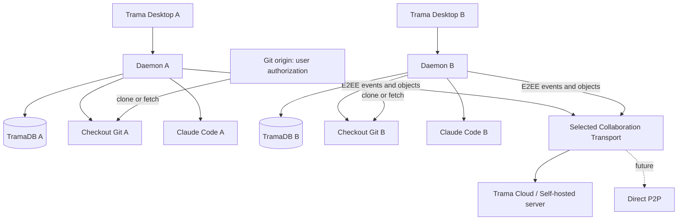

# 02 — Architettura target e flussi

**Status:** proposta. Sfrutta il daemon locale esistente, `trama-db`, `trama-infra` e il servizio `trama-collab`; non richiede l'adozione immediata di CRDT.

## 1. Topologia target



Il **Git origin non è sostituito** dal server Trama. Il server Trama ha due mansioni distinte: **control plane** (ACL, membership, ordinamento/versioni, presenza, notifiche) e **data plane** (pacchetti cifrati e oggetti content-addressed). Queste mansioni possono coesistere in un singolo processo nel MVP, pur restando separate nel protocollo.

## 2. Moduli e responsabilità

| Nuovo/esteso modulo | Responsabilità | Vincoli |
|---|---|---|
| `trama-domain::share` (nuovo) | Share, scope, capability, policy, perimetri, revisioni | No I/O, no URL raw non validati |
| `trama-domain::checkout_state` (nuovo) | Manifest logico di `(thread, repository)` e stato versione | Immutable IDs |
| `trama-infra::share_git` (nuovo) | Snapshot `HEAD/index/worktree`, bundle/packs, verify, import | Mai mutare source repo |
| `trama-db::{share, share_objects}` (nuovo) | Metadata locale, outbox/ack, cursori, contenuti importati | Solo migrazioni in append |
| `trama-collab-protocol` | Payload/frames vNext, negoziazione capabilities | Nessun riferimento a JSON plaintext di dati sensibili |
| `trama-daemon::collab` | Session orchestration, import, share policy, runner | Riusa `family`, `outbox`, `mirror` |
| `trama-collab` | ACL, event log, storage di blob cifrati, quota, retention | Non deve poter leggere plaintext E2EE |
| `trama-desktop` | Share wizard, Join wizard, monitor sync, errori | Distinguere file pronti da metadata pronti |
| `Transport` (interfaccia) | Pubblicazione eventi, download oggetti, subscribe/presence | `Cloud`, `SelfHosted`; `P2P` successivo |

## 3. I due piani di sync

**A. Metadata:** create/update share, thread tree, messaggi, annotazioni, commenti, verdict, presenza, `checkout_state_published`, membership. Per il backend server-based il server può mantenere un sequenziatore per share/thread, ma l'ID autore e l'ID evento devono restare stabili per futuri trasporti P2P.

**B. Content:** un `checkout_state` indica `head_commit`, `index_tree`, `working_tree` e gli oggetti Git aggiuntivi. Oggetti grandi sono caricati/download in chunk cifrati con resume; il server vede solo ID opachi e metadati minimi. Nessun diff di presentazione è necessario per ricostruire i file.

Il vecchio `ChangesSnapshot` rimane **solo preview diff**. Il suo limite 150 KiB/300 file (`apps/trama-daemon/src/collab/family.rs`) è incompatibile con un ripristino byte-identico e non deve essere riutilizzato.

## 4. Flusso iniziale Share/Join

```mermaid
sequenceDiagram
  participant A as Daemon Alice
  participant S as Collab Service
  participant B as Daemon Bob
  participant G as Git Origin
  A->>A: Resolve explicit scope and ACL
  A->>A: Reserve checkouts; snapshot tree/index/head
  A->>A: Collect missing Git objects; encrypt chunks
  A->>S: Create share + encrypted manifest + blobs
  S-->>A: Receipt + immutable snapshot version
  A-->>B: Invite or link (encrypted key material)
  B->>S: Authenticate + request membership
  S-->>B: Encrypted manifest, events, blob inventory
  B->>B: Verify identity/signatures and scope
  B->>G: Clone/fetch with Bob's own credentials
  G-->>B: Git objects available to Bob
  B->>S: Fetch only missing encrypted Git objects
  S-->>B: Chunks encrypted end-to-end
  B->>B: Verify + materialize staged isolated checkouts
  B->>B: Restore index/worktree + thread histories
  B->>S: Publish durable joined/ack cursor
```

**Atomicità del manifest:** lo share diventa «Ready» soltanto dopo upload e verifica di **tutti** i checkout/state references dello snapshot iniziale. Prima: `Preparing`/`Incomplete`, non può generare un link che promette accesso a dati incompleti. Per snapshot grandi si può emettere un link in stato `Preparing`, ma Join resta in attesa esplicita e non produce copie parzialmente pronte.

## 5. Esportazione coerente di più thread

Con 25 subthread non si può fermare l'intera applicazione per minuti mentre partono gli upload. Approccio:

1. Selezionare e fissare la **membership** dell'albero (watermark). Segnare `share_snapshot_version=N`.
2. Riservare brevemente ciascun checkout e registrare snapshot immutabili in Git; i processi in corso che scrivono impediscono la pubblicazione «exact at instant» fino a barriera di quiescenza o ne producono una versione coerente *per-thread*, dichiarata esplicitamente.
3. Caricare gli oggetti immutabili in background dal daemon, senza tenere bloccati i checkout dopo la cattura. I nuovi cambiamenti generano nuove versioni differenziali.
4. Sigillare il manifest family solo quando tutti gli stati corrispondono al set/versione catturata; gli eventi successivi verranno consegnati nel log live.

**Contratto MVP:** snapshot consistente **per checkout**, con punto di consistenza della family basato su watermark, non transazione globale atomica di filesystem multipli. Se un turno è in corso, la UI propone «attendi fine turno» oppure «snapshot dell'ultimo checkpoint completo»; non definire ambiguamente istanti diversi come un solo stato globale.

## 6. Transizioni di stato del join

`Invited` → `Authorized` → `FetchingGit` → `FetchingContent` → `Verifying` → `Materializing` → `Ready`; errori: `NeedsGitAccess`, `MissingObject`, `ForbiddenByPolicy`, `IntegrityFailed`, `WaitingForHost`, `PartialNoCode`, `Conflict`, `RetryableNetworkError`.

Un Join può essere ripreso dal cursor e dall'inventario dei chunk scaricati. Gli stati intermedi hanno un percorso staging privato, **mai** esposto come checkout operativo. Solo `Ready` abilita l'agente, editor e Pull Changes.

## 6bis. Proof dei permessi Git prima del code grant

Se la policy dello share è `git_authorization_required`, il server di collaborazione non può limitarsi a fidarsi del fatto che il client dichiari `clone_succeeded=true`. Prima di distribuire le chiavi code, un componente di trust (provider Git via API OAuth minimale oppure attestatore aziendale firmato) deve provare che **quell'identità** ha accesso a **tutti** i repository previsti. Il grantor verifica la proof e firma il `read_code` grant vincolato al share, repository, device e validità. Un clone locale è poi necessario per ricostruire il progetto. In assenza di proof, si può offrire `history_only` ma mai il code envelope.

Questo evita la falsa sicurezza di inviare un bundle E2EE e verificare i permessi solo nell'interfaccia: chi riceve il bundle e la chiave può comunque leggerne i blob.

## 7. Invarianti di esecuzione Claude

L'attuale ADR 0008 impone che il turno giri sulla macchina dell'autore che preme Send, usando il suo CLI e checkout. La nuova architettura lo mantiene. Ogni runner può eseguire solo i turn che ha creato e accettato localmente; il server non può decidere di far eseguire un comando sulla macchina di un'altra persona. All'import un partecipante riceve **contesto di thread** ma non la sessione o credenziali Claude di altri.

## 8. Design boundaries

- Distinguere `transport != authorization != crypto != snapshot manager`. Evita di creare una `CollabService` monolitica con feature flag sparsi.
- `workspace` è multi-repo: gli stati hanno chiavi composte `(share_id, thread_global_id, repository_identity, revision)`.
- Parent/sibling non autorizzati non possono essere letti né referenziati tramite object fetch, grep, search e preview.
- Nessun fallback da `restricted` a `public relay` dopo errori di connessione.
